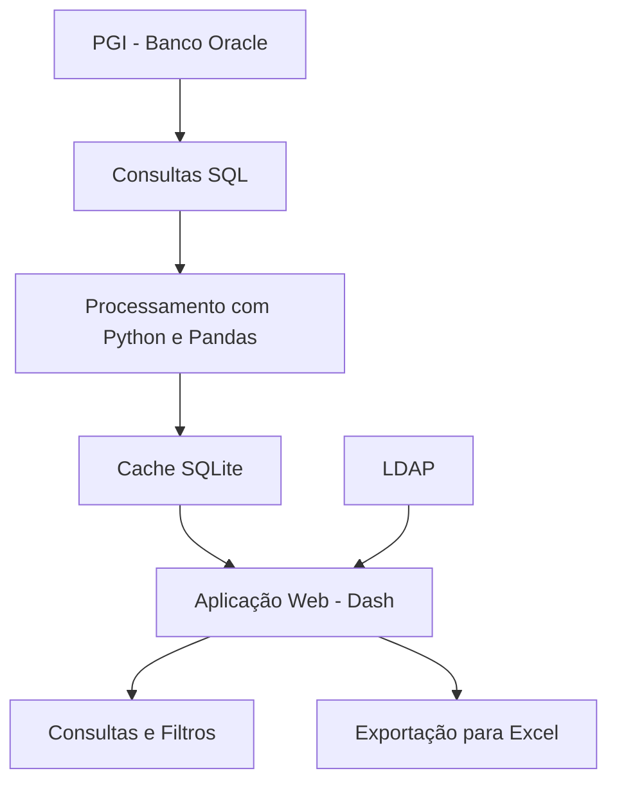

# Portal de Consultas PGI

Aplicação web desenvolvida em Python e Dash para consulta, consolidação e análise de dados financeiros provenientes do PGI, sistema corporativo utilizado na gestão de empreendimentos.

O projeto integra dados do banco Oracle por meio de consultas SQL, disponibilizando uma visão consolidada das informações relacionadas a compras, notas fiscais, fornecedores, contratos e centros de custo.

## Contexto e objetivo

O projeto surgiu da necessidade de facilitar o acesso às informações financeiras registradas no sistema corporativo, centralizando a consulta dos dados em uma interface web.

A solução foi desenvolvida para proporcionar maior autonomia aos usuários na exploração das informações, simplificar consultas financeiras e facilitar a extração de dados para análises complementares.

## Funcionalidades

- Integração com banco de dados Oracle.
- Extração e consolidação de dados por meio de consultas SQL.
- Manipulação e tratamento de dados com Python e Pandas.
- Utilização de SQLite para armazenamento em cache.
- Autenticação corporativa via LDAP.
- Controle de sessão e timeout automático.
- Consultas com múltiplos filtros.
- Visualização tabular interativa com paginação.
- Exportação de dados para Excel com formatação automatizada.
- Interface web responsiva.
- Registro do histórico de acessos.

## Interface da aplicação

### Tela de autenticação


### Mapa de Controle


## Módulos da aplicação

| Módulo | Descrição | Situação |
|---|---|---|
| Mapa de Controle | Consulta consolidada dos lançamentos financeiros relacionados às compras de materiais destinados às obras. | Implementado |
| Análise de Contrato | Visão analítica dos contratos e lançamentos financeiros associados aos fornecedores. | Em desenvolvimento |
| Saldo de Contrato | Visão consolidada dos contratos firmados e seus respectivos saldos. | Em desenvolvimento |

## Filtros disponíveis

O módulo Mapa de Controle permite a exploração dos dados por diferentes dimensões de negócio.

| Filtro | Descrição |
|---|---|
| SC | Solicitação de Compra |
| PC | Pedido de Compra |
| NF | Nota Fiscal |
| UO | Unidade Organizacional — empreendimento |
| Insumo | Material solicitado ou adquirido |
| Fornecedor | Empresa fornecedora de produtos ou serviços |
| UA | Unidade Analítica — centro de custo ou unidade contábil |

## Fluxo de dados

A aplicação utiliza a view `vw_financeiro_obra` como fonte de dados para o módulo Mapa de Controle.



## Tecnologias utilizadas

| Tecnologia | Finalidade |
|---|---|
| Python | Desenvolvimento e processamento de dados |
| SQL | Consulta e extração de dados |
| Oracle Database | Banco de dados de origem |
| SQLite | Armazenamento em cache |
| Pandas | Manipulação e tratamento de dados |
| Dash | Desenvolvimento da aplicação web |
| Dash Bootstrap Components | Componentes visuais e responsividade |
| SQLAlchemy | Conexão e integração com banco de dados |
| oracledb | Driver de conexão com Oracle |
| LDAP / ldap3 | Autenticação corporativa |
| XlsxWriter | Geração e formatação de arquivos Excel |
| python-dotenv | Gerenciamento de variáveis de ambiente |
| CSS | Estilização da interface |

## Estrutura do projeto

```text
.
├── app.py
├── layout_inicial.py
├── callbacks_inicial.py
├── request.py
├── ldap_auth.py
├── scheduler.py
├── cache_sqlite.py
├── menu_mapa_controle/
│   ├── layout.py
│   └── callbacks.py
├── menu_analise_contrato/
│   ├── layout.py
│   └── callbacks.py
├── menu_saldo_contrato/
│   ├── layout.py
│   └── callbacks.py
├── assets/
│   ├── styles.css
│   └── images/
│       ├── img_1.png
│       └── img_2.png
├── shared_data/
└── requirements.txt
```

## Como executar

### 1. Clonar o repositório

```bash
git clone https://github.com/paesdj1987/relatorio_financeiro.git
cd relatorio_financeiro
```

### 2. Criar um ambiente virtual

```bash
python -m venv .venv
```

Ativação no Windows:

```bash
.venv\Scripts\activate
```

Ativação no Linux:

```bash
source .venv/bin/activate
```

### 3. Instalar as dependências

```bash
pip install -r requirements.txt
```

### 4. Configurar as variáveis de ambiente

Crie um arquivo `.env` na raiz do projeto:

```env
FLASK_SECRET=

LDAP_SERVER=
LDAP_BIND_DN=
LDAP_BIND_PASSWORD=
LDAP_BASE_DN=

ORACLE_USER=
ORACLE_PASSWORD=
ORACLE_HOST=
ORACLE_PORT=
ORACLE_SERVICE=
ORACLE_INSTANT_CLIENT_PATH=
```

### 5. Executar a aplicação

```bash
python app.py
```

**Observação:** o funcionamento integral da aplicação depende do acesso ao banco de dados Oracle e ao serviço de autenticação LDAP do ambiente corporativo de origem.

## Competências aplicadas

- Extração e transformação de dados.
- Desenvolvimento de consultas SQL.
- Integração com bancos de dados relacionais.
- Consolidação de informações financeiras.
- Desenvolvimento de aplicações web orientadas a dados.
- Autenticação e controle de acesso.
- Automação da geração de relatórios.

## Autor

**João Paes**

- [GitHub](https://github.com/paesdj1987)
- [LinkedIn](https://www.linkedin.com/in/joao-paes87)
- [Portfólio](https://joao-paes.vercel.app/)
